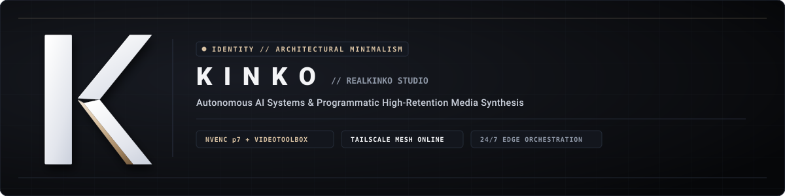

<div align="center">



<br/><br/>

<p align="center">
  <strong>Principal Systems Architect specializing in autonomous AI pipelines, programmatic high-retention media synthesis, and distributed hardware compute clusters. Designing resilient, zero-clutter software architectures that translate raw multimodal inputs into deterministic, high-throughput execution.</strong>
</p>

<p align="center">
  <a href="https://github.com/Renziac"></a>
  <a href="https://t.me/R23piBot"></a>
  <a href="https://instagram.com/OfficialR23A"></a>
  <a href="https://github.com/Renziac"></a>
</p>

</div>

<br/>

### `// DISTRIBUTED COMPUTE TOPOLOGY`

<div align="center">
  
</div>

<br/>

### `// CORE ENGINEERING MATRIX`

<div align="center">
  
</div>

<br/>

### `// SYSTEM TELEMETRY`

<div align="center">

<table border="0" style="border: none; background: transparent; width: 100%;">
  <tr>
    <td align="center" width="50%">
      
    </td>
    <td align="center" width="50%">
      
    </td>
  </tr>
</table>

</div>

<br/>

---

<div align="center">

```
========================================================================================
                      ENGINEERED FOR AUTONOMY // KINKO IDENTITY
========================================================================================
```

</div>
